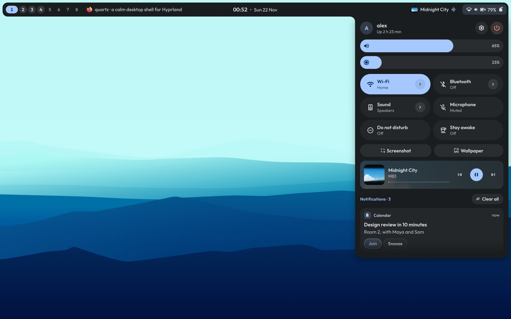
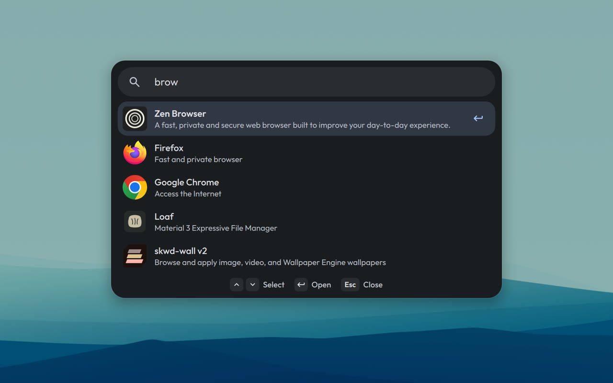
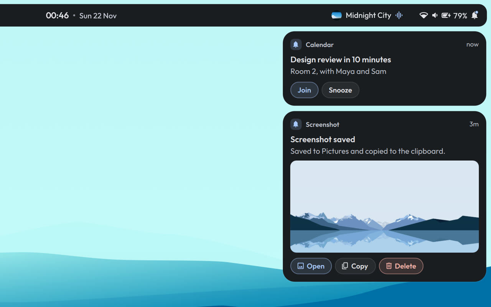
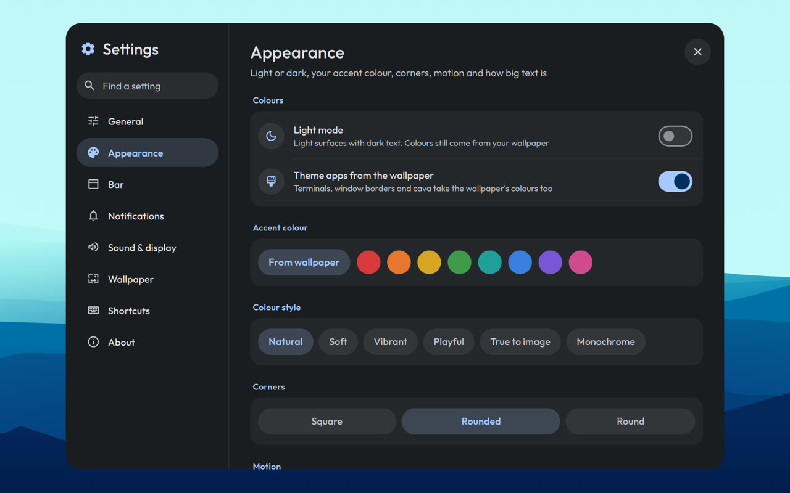
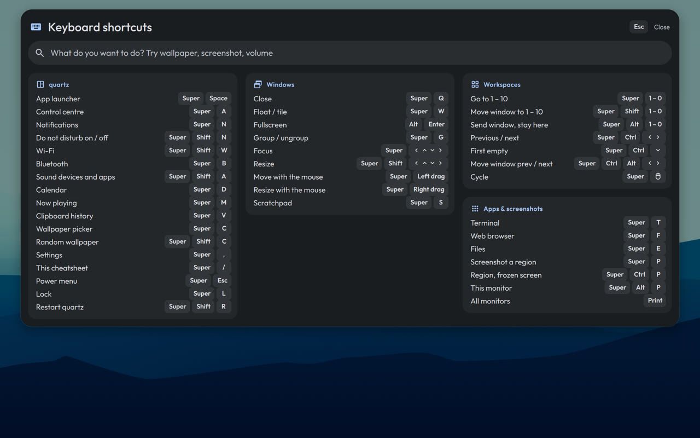
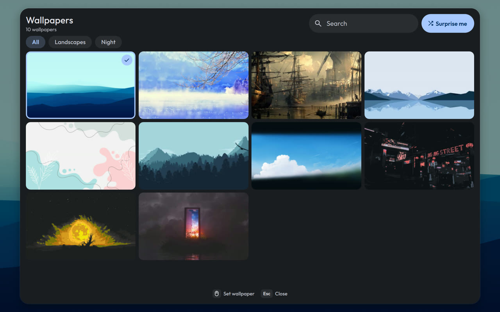
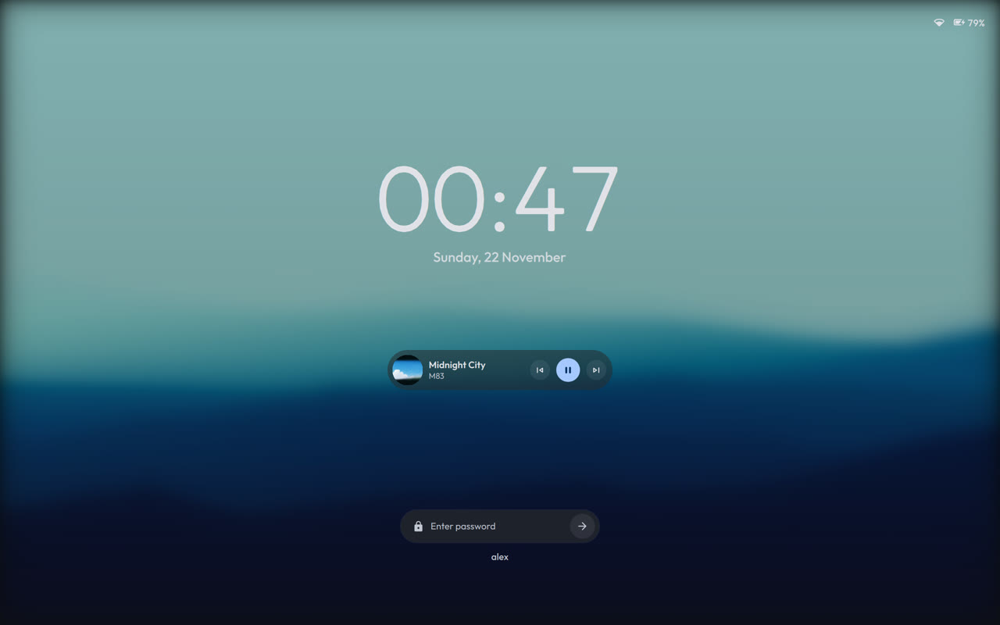

<div align="center">

# quartz

A calm, complete desktop shell for [Hyprland](https://hyprland.org), built with [Quickshell](https://quickshell.org).

</div>



<table>
  <tr>
    <td></td>
    <td></td>
  </tr>
  <tr>
    <td></td>
    <td></td>
  </tr>
  <tr>
    <td></td>
    <td></td>
  </tr>
</table>

## Features

- **Bar**: workspaces, the window you're in, the clock, what's playing, the tray and your status icons.
- **Panels from the bar**: the control centre, calendar, now playing and tray menus unfold right under what you clicked.
- **Control centre**: volume, brightness, Wi-Fi, Bluetooth, sound devices, do not disturb and your notifications.
- **Notifications**: pop-ups with their actions, and screenshots with a preview and Open / Copy / Delete.
- **Launcher**: fuzzy app search; type a sum and Enter copies the answer.
- **Clipboard history**: text and images, searchable.
- **Wallpapers**: a picker with folders and search; the whole desktop takes the new wallpaper's colours.
- **App colours**: Ghostty, window borders, GTK and Qt apps, Firefox / Zen (pywalfox), Chrome, btop and fzf follow the wallpaper too (matugen, [`config/matugen`](config/matugen)).
- **Settings**: light or dark, accent colour, corners, motion, text size, bar items, night light and power mode; screen scale per monitor, text size in apps and the terminal, cursor size, keyboard layout and the touchpad.
- **Shortcuts**: Super + / lists every key, searchable, with links to the matching settings.
- **Lock screen, power menu and on-screen volume and brightness.**
- **Light**: nothing runs at rest, and a panel only exists while it's open.

## Install

On Arch (a fresh install is fine), as your normal user:

```sh
sudo pacman -Syu --needed git
git clone https://github.com/immortal-forest/quartz ~/quartz
cd ~/quartz && ./install.sh
```

Then log in on the console and run `start-hyprland`. quartz starts with it.

The installer explains each step and asks before it changes anything:

1. Checks everything the rice uses and nothing else: Hyprland, Quickshell, sound
   (PipeWire), Bluetooth, Wi-Fi, screenshots, the terminal and shell tools. All
   of it comes from the Arch repos.
2. Looks at your graphics (on a hybrid laptop: the built-in GPU draws the desktop)
   and your sound chip (adds its firmware when the speakers need it).
3. Installs what's missing, showing each command first; starts sound, Bluetooth
   and NetworkManager.
4. Fonts (Outfit, Material Symbols) and quartz's cursor (Bibata Modern Ice).
5. Links the shell to `~/.config/quickshell/quartz`.
6. Terminal and shell: Ghostty, zsh with plugins, a starship prompt, and
   quartz's scripts in `~/.local/bin`.
7. Hyprland: a fresh setup gets quartz's clean config, whose keys are exactly
   the ones Super + / shows. An existing config is kept and quartz adds one
   marked block at the end.
8. Your wallpaper folder, with 12 wallpapers to start with.
9. Reloads Hyprland and starts quartz.

Where you already have a config (Hyprland, `.zshrc`, Ghostty, starship) it asks
before replacing it, and keeps yours by default. Anything it replaces is moved
aside, not deleted. It's safe to run again: it only does what isn't done yet.

| Option | |
|---|---|
| `--dry-run` | show every step and command, change nothing |
| `--yes` | take the default answer to every question |
| `--uninstall` | undo all of it: quartz's configs, links, fonts, cursor, wallpapers, settings and caches go, your configs come back, and it offers to remove the packages it installed |
| `--reinstall` | `--uninstall` (keeping the packages), then install again |
| `--help` | the short version |

### What it uses

| For | Package |
|---|---|
| The shell | `hyprland`, `quickshell` |
| Colours from the wallpaper | `matugen` |
| Wallpapers | `awww`, `ffmpeg` |
| Clipboard | `wl-clipboard`, `cliphist` |
| Sound | `pipewire-pulse`, `wireplumber` (and `sof-firmware` on chips that need it) |
| Brightness, night light, power mode | `brightnessctl`, `hyprsunset`, `power-profiles-daemon` |
| Wi-Fi, Bluetooth, battery | `networkmanager`, `bluez`, `upower` |
| Idle (dim, lock, screen off, sleep) | `hypridle` |
| Password prompts, screen sharing, file pickers | `hyprpolkitagent`, `xdg-desktop-portal-hyprland`, `xdg-desktop-portal-gtk` |
| Screenshots, opening files | `hyprshot`, `xdg-utils` |
| Terminal and shell | `ghostty`, `zsh`, `starship`, `git`, `fzf`, `zoxide`, `eza` |
| Fonts | `ttf-material-symbols-variable`, [Outfit](https://fonts.google.com/specimen/Outfit) |

Its configs are in [`config/`](config), the wallpapers in [`wallpapers/`](wallpapers).

### Without the installer

With a Lua config (`hyprland.lua`):

```lua
local quartz = dofile(os.getenv("HOME") .. "/quartz/hypr/quartz.lua")
quartz.setup({ mod = "SUPER", autostart = true, clipboard = true })
```

Add `essentials = true` for quartz's full keymap (windows, workspaces, apps,
screenshots) and `take_over = true` to let it replace your own binds on the
same keys. For quartz's cursor, unpack
[`cursors/Bibata-Modern-Ice.tar.gz`](cursors) into `~/.local/share/icons` and
add `cursor = "Bibata-Modern-Ice"`. Every option is listed at the top of
[`hypr/quartz.lua`](hypr/quartz.lua).

With a classic config (`hyprland.conf`):

```ini
exec-once = qs -c quartz -d
exec-once = wl-paste --type text --watch cliphist store
exec-once = wl-paste --type image --watch cliphist store

bind = SUPER, SPACE,  global, quartz:launcher
bind = SUPER, V,      global, quartz:clipboard
bind = SUPER, ESCAPE, global, quartz:power
bind = SUPER, A,      global, quartz:control
bind = SUPER, N,      global, quartz:control
bind = SUPER SHIFT, N, global, quartz:dnd
bind = SUPER SHIFT, W, global, quartz:wifi
bind = SUPER, B,      global, quartz:bluetooth
bind = SUPER SHIFT, A, global, quartz:sound
bind = SUPER, D,      global, quartz:calendar
bind = SUPER, M,      global, quartz:media
bind = SUPER, COMMA,  global, quartz:settings
bind = SUPER, SLASH,  global, quartz:help
bind = SUPER, C,      global, quartz:wallpapers
bind = SUPER SHIFT, C, global, quartz:randomWallpaper
bind = SUPER, L,      exec, loginctl lock-session
bindl = , XF86AudioPlay, global, quartz:mediaToggle
bindl = , XF86AudioNext, global, quartz:mediaNext
bindl = , XF86AudioPrev, global, quartz:mediaPrev
bindel = , XF86MonBrightnessUp,   exec, qs -c quartz ipc call quartz brightness 5
bindel = , XF86MonBrightnessDown, exec, qs -c quartz ipc call quartz brightness -- -5
```

Also turn off Hyprland's layer animations for the namespaces `quartz-panel`,
`quartz-toast`, `quartz-osd` and `quartz-overlay` (quartz animates them
itself), blur `quartz-frost`, and float and centre the window titled
`Settings · quartz` (class `org.quickshell`). The rule syntax depends on your
Hyprland version. The Lua snippet above has been tested; this classic one
hasn't.

## Keys

| Key | |
|---|---|
| Super + Space | App launcher |
| Super + A | Control centre |
| Super + N | Notifications |
| Super + Shift + N | Do not disturb on / off |
| Super + Shift + W | Wi-Fi |
| Super + B | Bluetooth |
| Super + Shift + A | Sound devices and apps |
| Super + D | Calendar |
| Super + M | Now playing |
| Super + V | Clipboard history |
| Super + C | Wallpaper picker |
| Super + Shift + C | Random wallpaper |
| Super + , | Settings |
| Super + / | Every shortcut, searchable |
| Super + Esc | Power menu |
| Super + L | Lock |

With the full keymap there's also Super + Q to close, Super + W to float,
Alt + Enter for fullscreen, Super + 1–0 for workspaces, Super + T / F / E for
the terminal, browser and files, and Super + P for screenshots. Super + / shows
everything that's really bound.

In the bar, click the clock for the calendar and the status icons for the
control centre. Scroll on the workspaces to switch, or on the status icons to
change the volume.

## Settings

Super + , opens the settings window. Every option says what it does, and the
search box finds any of them. The first time quartz starts, a short welcome
guide shows the keys that get you around. Settings are saved in
`~/.local/state/quartz/config.json`.

## Scripting

```sh
qs -c quartz ipc call quartz launcher                 # also: clipboard, power, wallpapers, help, settings, lock, close
qs -c quartz ipc call quartz panel control:bluetooth  # control[:wifi|bluetooth|audio], calendar, media
qs -c quartz ipc call quartz setWallpaper ~/wallpapers/sea.jpg
qs -c quartz ipc call quartz volume 5                 # also: brightness 5, mic, dnd, randomWallpaper
```

## Updating

```sh
cd ~/quartz && git pull && ./install.sh
```

On Hyprland's `-git` packages from the AUR, `scripts/update-hyprland` rebuilds
the ones you have, one at a time in the order the Hyprland wiki asks for, so a
library bump can't leave the rest broken. `--check` shows what it would
rebuild; `--force` rebuilds all of them.

## Credits

[Quickshell](https://quickshell.org) ·
[Hyprland](https://hyprland.org) ·
[matugen](https://github.com/InioX/matugen) ·
[Material Symbols](https://fonts.google.com/icons) ·
[Outfit](https://fonts.google.com/specimen/Outfit) ·
[awww](https://codeberg.org/LGFae/awww) ·
[cliphist](https://github.com/sentriz/cliphist) ·
[hyprshot](https://github.com/Gustash/Hyprshot) ·
[Bibata Cursor](https://github.com/ful1e5/Bibata_Cursor) (GPL-3.0, in [`cursors/`](cursors))

## Licence

quartz is free software under the [GNU GPL v3](LICENSE). The bundled cursor
(Bibata Cursor) is GPL-3.0 too; see [`cursors/`](cursors).
